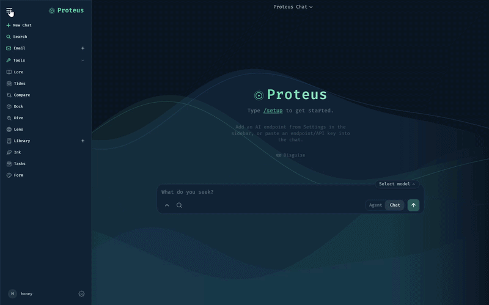
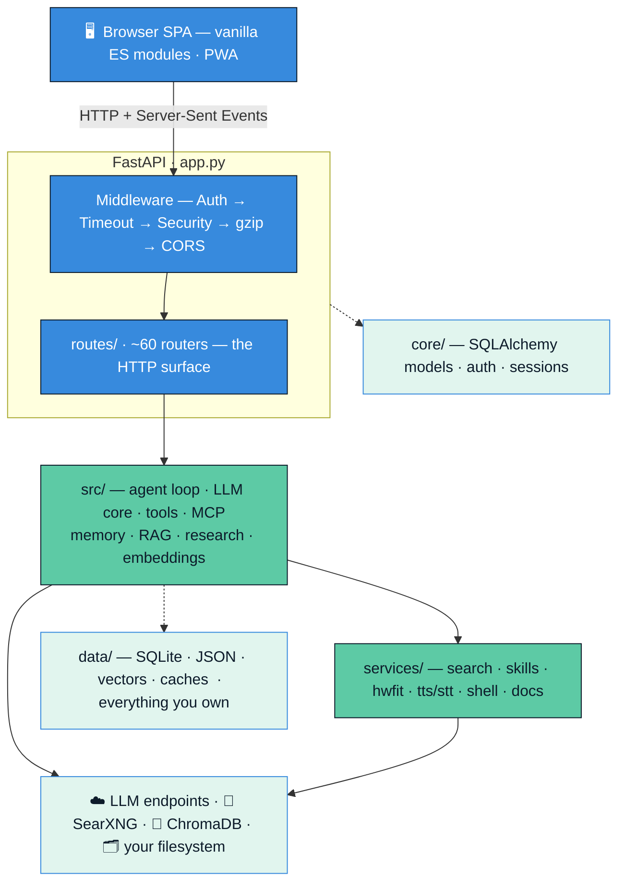
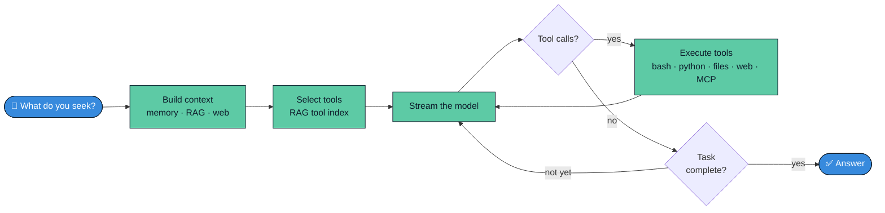

<div align="center">


# Proteus

### Any model. Any tool. Entirely yours.

*The shape-shifting, self-hosted AI workspace — memory, research, documents, and a hundred tools, running on your machine and answering only to you.*

[](#)
[](#)
[](#)
[](#)

<br />



<br />

<sub>One workspace. Many shapes. <em>"What do you seek?"</em></sub>

</div>

---

## The story behind the name

In Greek myth, **Proteus** was the old god of the sea — the *herdsman of the deep*. Two things made him remarkable.

First, he was a **shape-shifter**. Grab hold of him and he would become a lion, a serpent, a torrent of water, a tree, fire — anything to slip your grasp. He was never just one thing.

Second, he was an **oracle**. Proteus knew the answer to *any* question — past, present, or future. But he would only tell you the truth if you could hold on through every shape he took. Those who held fast were rewarded with knowledge no one else could give.

That myth is the whole idea behind this project.

A good AI assistant shouldn't be a single rigid tool. One moment it's a **researcher** crawling the open web; the next it's a **coder** running a shell, a **writer** editing a living document, an **image editor**, an **inbox**, a **calendar**, a **memory** that actually remembers you. It changes shape to fit the task in front of it — and underneath every transformation there's *one constant self*: your data, your models, your machine.

Look closely at the logo. The outer **ocean-blue ring** is the boundary of what Proteus can become. The **sea-teal morphing form** inside is the shape-shifter, never settling. And right at the center sits a small, bright, unchanging node — **the constant self**. That's you, and that's your data. Everything moves around it; nothing replaces it.

> **Proteus is an AI workspace that takes any shape you need — and keeps everything it learns about you on hardware you control.**

---

## Why Proteus exists

Most AI apps ask you to make a quiet trade: convenience in exchange for your conversations, your documents, your habits, and a monthly bill. Your "memory" lives on someone else's servers. Your model choices are made for you. The moment you cancel, it all disappears.

Proteus is built on the opposite bet — **local-first, you-first**:

- 🏠 **Self-hosted.** It runs on your laptop, your home server, or your own cloud box. There is no Proteus account and no Proteus cloud.
- 🔌 **Bring your own brains.** Point it at local models (Ollama, llama.cpp, vLLM, LM Studio) or hosted APIs (OpenAI, Anthropic, Groq, OpenRouter, GitHub Copilot, and more). Mix and match. Switch mid-conversation.
- 🗝️ **You own the data.** Everything lives in one `data/` directory — a SQLite database and a handful of JSON files. Back it up, grep it, move it, delete it. Secrets are encrypted at rest.
- 🧩 **Hackable by design.** No build step on the frontend, a clean modular backend, and code that's yours to read, fork, and bend into your own shape.
- 🛡️ **Private by default.** Auth on by default, owner-scoped multi-user support, prompt-injection hardening, and tool sandboxing baked in.

If you've ever wanted ChatGPT's polish with a homelab's freedom, that's the gap Proteus is trying to close.

---

## A tour of its shapes

Proteus is genuinely broad. And true to the myth, its tools don't have boring names — they carry the language of the sea and the oracle. The composer doesn't ask "How can I help?"; it asks **"What do you seek?"** Here's the deck, and what each shape really is:

| In Proteus | What it is |
| --- | --- |
| 💬 **Chat / Agent** | Conversation, or a tool-using agent that *acts* |
| 🎭 **Disguise** | Incognito mode — a session that leaves no trace |
| 📖 **Lore** | Long-term memory + learned skills |
| 🌊 **Dive** | Deep, multi-source web research |
| 🔭 **Lens** | Image generation + a full layered image editor & gallery |
| 📚 **Library** | Living documents, PDFs & artifacts the AI edits in place |
| 🕯️ **Ink** | Notes, lists & quick capture |
| 🌓 **Tides** | Calendar & scheduling |
| ⚓ **Dock** | The model lab — download, serve & "What Fits?" |
| ⚖️ **Compare** | Run models head-to-head and vote |
| ✉️ **Email** | Multi-account inbox with AI summaries & replies |
| 🪶 **Form** | Themes & appearance — give Proteus its shape |
| ⏱️ **Tasks** | Scheduled & event-triggered automations |

### 💬 Chat & the agentic loop
A fast, streaming chat interface with markdown, syntax highlighting, LaTeX, and diagrams — and a composer that asks *"What do you seek?"* Toggle from **Chat** to **Agent** and it stops just *talking* and starts *doing*: a multi-step loop that calls tools, reads results, and keeps going until the job is done. There's a read-only **Plan mode** for "investigate first, act after I approve," a **Guide-only mode** for advice without action, **Disguise** (incognito) for sessions that leave no trace, and smart context compaction so long conversations never fall off a cliff.

### 📖 Lore — memory & skills that actually stick
Proteus quietly learns durable facts about you — who you are, what you prefer, who your contacts are — and recalls them with a hybrid keyword + vector search. It's not a black box: you can browse, search, edit, categorize, import/export, and audit every memory it holds. **Lore** also houses *skills* — when the agent solves something hard, Proteus can distill the procedure into a reusable `SKILL.md`, gate it behind a confidence threshold, audit it nightly, and pull it back out next time a similar task appears. It gets better the more you use it (and you can import skill bundles from GitHub).

### 📚 Library — RAG, personal documents & living artifacts
Drop in your own PDFs, Office docs, EPUBs, or text and Proteus indexes them into a local vector store (ChromaDB) for retrieval-augmented answers grounded in *your* files — embeddings run locally by default (ONNX/fastembed). The AI can also create and edit documents *in place*, with full version history: markdown, code, and even **fillable PDF forms**, complete with a sign-and-reply flow for documents that arrive as email attachments.

### 🌊 Dive — deep research
Ask a real question and **Dive** runs an iterative, LLM-in-the-loop research engine: it plans sub-questions, searches the web across multiple providers (SearXNG, Brave, DuckDuckGo, Tavily, Google PSE, Serper — with automatic fallback chains), extracts what matters, synthesizes findings round after round, and hands you a polished, **cited** report rendered as a clean web page.

### 🔭 Lens — image generation & a full image editor
Generate images through OpenAI-compatible endpoints, then open them in a genuinely capable, layered, Photoshop-style editor — brushes, masks, transforms, filters, plus AI tools like inpainting and background removal. Everything lands in a searchable **gallery** with albums and EXIF metadata.

### ✉️ Email, 🌓 Tides & contacts
Multi-account IMAP/SMTP **Email** with AI summaries, threading, scheduled send, and style-matched replies. **Tides** is a CalDAV calendar with recurring events and ICS import/export. CardDAV contacts round it out. Your communications hub, self-hosted.

### ⏱️ Tasks & your personal assistant
Cron-style and event-triggered tasks that run LLM prompts or direct actions on a schedule. Define **crew members** — custom AI personas with their own model, personality, and tools — including a personal assistant that checks in on you morning, midday, and evening.

### ⚓ Dock — the model lab & "What Fits?"
**Dock** is mission control for models: download them, serve them locally (vLLM / llama.cpp via tmux), and use the hardware-aware **"What Fits?"** engine that scans your GPU/CPU/RAM and ranks thousands of models by quality, speed, and whether they'll actually run on your box — quantization math included.

### ⚖️ Compare — models head to head
Run the same prompt across multiple models side by side, blind-vote on the best answer, and build a scoreboard. Find out which model is actually best *for you*.

### 🗣️ Voice in and out
Speech-to-text (local Whisper or API) and text-to-speech (local Kokoro or API) for hands-free conversation.

### 🔗 Integrations & companions
Scoped API tokens let **Claude Code** and **Codex** terminal sessions reach into your todos, email, calendar, and memory — only as far as you allow. A **companion** bridge lets phones on your LAN discover and pair with your server. Outbound **webhooks** fire on events for n8n, Zapier, Make, and friends.

### 🪶 Form — a workspace, not just a chatbox
**Form** lets you reshape Proteus itself: 20+ themes with a pre-render engine (no flash of unstyled content), a tiling window/modal manager, full PWA support (installable, offline-aware), and per-tool deep links. The shapeshifter even gets to choose its own skin.

---

## More views

> _Want to show more? Drop additional captures in `docs/screenshots/` and link them here — the **Lens** image editor, a **Dive** research report, and the **Dock** "What Fits?" tab all make great showcases._

---

## Quick start

### Option A — Docker (recommended)

The Compose stack brings up everything Proteus likes to have around it: the app, a **ChromaDB** vector store, a **SearXNG** search engine, and **ntfy** for push notifications.

```bash
git clone https://github.com/bsaathvik19/proteus.git
cd proteus

# Configure
cp .env.example .env
# (optional) edit .env — point LLM_HOST at your models, set keys, etc.

# Launch
docker compose up -d
```

Then open **http://localhost:7000**, create your admin account, and type **`/setup`** in the chat to connect your first model.

**GPU acceleration** (for local model serving) is available via overlay files:

```bash
# NVIDIA
COMPOSE_FILE=docker-compose.yml:docker/gpu.nvidia.yml docker compose up -d

# AMD ROCm (set RENDER_GID for your system)
COMPOSE_FILE=docker-compose.yml:docker/gpu.amd.yml docker compose up -d
```

### Option B — Run it natively

You'll need **Python 3.12**. ChromaDB and SearXNG are optional but recommended (RAG/search degrade gracefully without them).

**Linux / macOS:**
```bash
git clone https://github.com/bsaathvik19/proteus.git
cd proteus
python3 -m venv .venv && source .venv/bin/activate
pip install -r requirements.txt
# optional extras: local STT, PDF forms, Office docs, DuckDuckGo
pip install -r requirements-optional.txt
python setup.py            # idempotent: creates data/, stubs config
uvicorn app:app --host 127.0.0.1 --port 7000
```

**Windows (one command):**
```powershell
.\launch-windows.ps1 -Port 7000 -BindHost 127.0.0.1
```

**macOS** has `start-macos.sh` (and `build-macos-app.sh` to wrap it as a .app). **Linux** can install a systemd service with `install-service.sh`.

### Connecting your models

Proteus auto-discovers OpenAI-compatible endpoints. The fastest path is [Ollama](https://ollama.com):

```bash
ollama pull llama3.1
# Proteus scans common ports (including Ollama's 11434) automatically.
```

Or add any endpoint — local or hosted — from **Settings → Models** in the UI: vLLM, llama.cpp, LM Studio, OpenAI, Anthropic, Groq, OpenRouter, GitHub Copilot, and more.

---

## Configuration

Everything is driven by environment variables, fully documented in **[`.env.example`](.env.example)**. The knobs you'll reach for most:

| Variable | What it does | Default |
| --- | --- | --- |
| `LLM_HOST` / `LLM_HOSTS` | Where to discover models | `localhost` |
| `OPENAI_API_KEY` | Use OpenAI models | — |
| `AUTH_ENABLED` | Require login | `true` |
| `APP_BIND` / `APP_PORT` | Listen address & port | `127.0.0.1` / `7000` |
| `PROTEUS_DATA_DIR` | Where all your data lives | `./data` |
| `CHROMADB_HOST` / `CHROMADB_PORT` | Vector store location | `localhost` / `8100` |
| `SEARXNG_INSTANCE` | Web search backend | `http://localhost:8080` |
| `ALLOWED_ORIGINS` | CORS allowlist | localhost only |

> 🔒 **Exposing Proteus to a network?** Keep `AUTH_ENABLED=true`, leave `LOCALHOST_BYPASS=false`, set `APP_BIND=0.0.0.0` behind a reverse proxy with TLS, and turn on `SECURE_COOKIES`. Your secrets (API keys, mail passwords, signatures) are already encrypted at rest with a key in `data/.app_key` — guard that file.

---

## How it's built

Proteus is a **FastAPI** backend serving a **vanilla-JS single-page app** (no build step, no framework lock-in — just ES modules).



**At the heart** is the agentic loop in `src/agent_loop.py`: it classifies intent, selects only the relevant tools via a RAG-backed tool index (so small models aren't drowned in 50 schemas), assembles a cache-friendly system prompt, streams the model, executes tools — native (bash, python, files, web) or **MCP** servers — and verifies completion before stopping.



The tech stack: **FastAPI · SQLAlchemy/SQLite · ChromaDB · fastembed (ONNX) · httpx · Pydantic · the Model Context Protocol (MCP) · vanilla ES modules · PWA**.

For a deeper map of the codebase, generate one with the bundled docs or read through `app.py` — it's a deliberately slim orchestrator that shows how every piece is wired together.

---

## The CLI

Beyond the web UI, Proteus ships a **git-style command-line tool** for scripting and automation. Every subcommand emits clean JSON, so it composes beautifully with `jq`.

```bash
proteus                         # list all subcommands
proteus mail list --folder INBOX --limit 5
proteus memory search "project deadline"
proteus docs list
proteus research show <id>
proteus sessions list --archived only
```

There are ~20 subcommands (`mail`, `memory`, `docs`, `skills`, `research`, `sessions`, `notes`, `calendar`, `contacts`, `cookbook`, `tasks`, `gallery`, `backup`, `theme`, `webhook`, `mcp`, and more).

---

## Make it your own

Proteus is **open source and yours to bend**. Use it, fork it, tear out the parts you don't need, build the parts you wish existed. That's the entire point.

Some directions people take it:
- Add a new **MCP server** to give the agent a brand-new capability.
- Write a custom **theme** (they're just CSS variables).
- Add a **route** + a small frontend module to surface a new tool.
- Teach it a **skill** by hand, or let it learn one from a hard task.
- Wire it into your own automation through **API tokens** and **webhooks**.

Contributions are welcome. If you're sending a PR:
1. Fork and branch from `main`.
2. Keep changes focused; match the surrounding style.
3. Run the test suite (`pytest`) — the test taxonomy lives in `pyproject.toml` and `tests/`.
4. Open a PR with a clear description of the shape you're adding.

Found a bug or have an idea? Open an issue. Security concern? Please report it privately to the maintainer rather than in a public issue.

---

## Acknowledgements

Proteus is built on the shoulders of a lot of open work.

- **[ChromaDB](https://github.com/chroma-core/chroma)** — vector database powering Lore memory and Archive RAG search
- **[fastembed](https://github.com/qdrant/fastembed)** — ONNX-based embedding engine used for local vector retrieval
- **[SearXNG](https://github.com/searxng/searxng)** — privacy-respecting metasearch engine bundled for Dive research
- **[Ollama](https://github.com/ollama/ollama)** — local model serving integration
- **[llama.cpp](https://github.com/ggml-org/llama.cpp)** — GGUF model inference backend for Dock serving
- **[vLLM](https://github.com/vllm-project/vllm)** — high-throughput inference engine for Dock on NVIDIA/AMD
- **[Fira Code](https://github.com/tonsky/FiraCode)** — monospaced font used throughout the UI
- **[Inter](https://github.com/rsms/inter)** — sans-serif font used in supporting UI text
- **[highlight.js](https://github.com/highlightjs/highlight.js)** — syntax highlighting in chat and Archive
- **[Mammoth](https://github.com/mwilliamson/mammoth.js)** — `.docx` to HTML conversion in Archive
- **[html2pdf.js](https://github.com/eKoopmans/html2pdf.js)** — PDF export
- **[SheetJS](https://github.com/SheetJS/sheetjs)** — spreadsheet handling
- **[docx](https://github.com/dolanmiu/docx)** — Word document generation
- **[ntfy](https://github.com/binwiederhier/ntfy)** — push notification delivery for task reminders
- **[mkcert](https://github.com/FiloSottile/mkcert)** — locally-trusted certificate generation for HTTPS dev setups

And a huge thanks to **[Odysseus](https://github.com/pewdiepie-archdaemon/odysseus)** — a fellow traveller in these same waters who inspired Proteus to shape.


---

<div align="center">

**Proteus** — *take any shape; keep your self.*

Built for people who'd rather own their tools than rent them.

</div>
